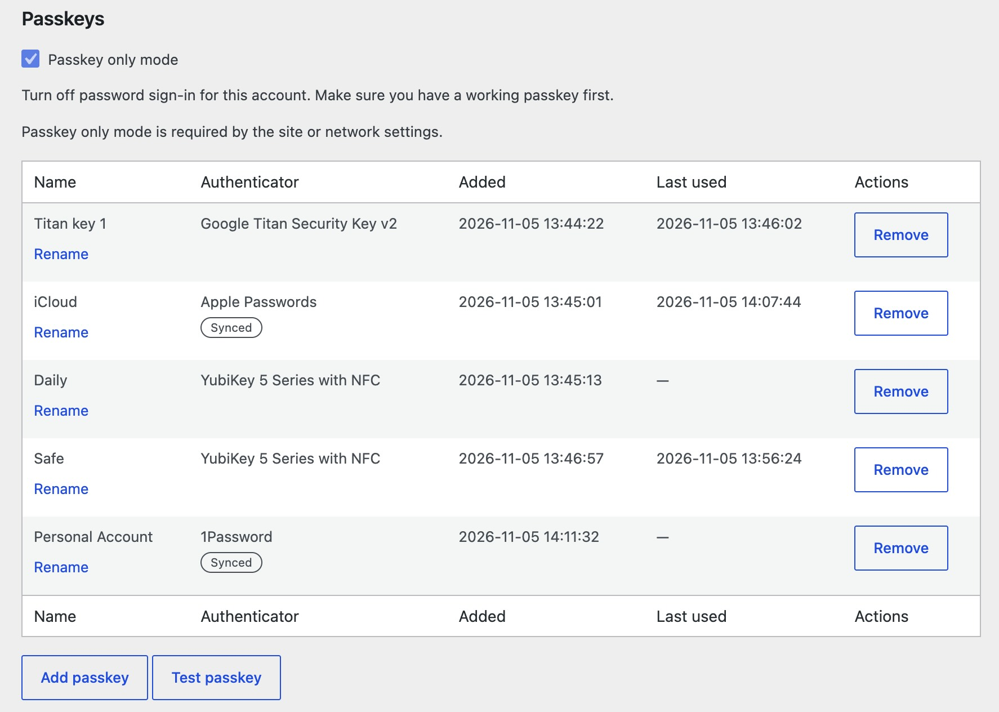

# AZ's WP Passkeys

Passkey sign-in and management for WordPress, with login integration, shortcodes, blocks and multisite support.



The [UX demo](https://raw.githack.com/arisdla/azwp-passkeys/main/wireframes/index.html) is a clickable wireframe of every screen. Its source is [wireframes/index.html](wireframes/index.html).

## Use

Requires WordPress 6.9, PHP 8.3 with OpenSSL, and HTTPS. Plain HTTP works only on `localhost`.

Database tables must use InnoDB, not MyISAM, because the plugin saves data in transactions. Otherwise activation fails. To convert a MyISAM table, back up the database and run `ALTER TABLE <table> ENGINE=InnoDB`.

Download `azwp-passkeys.zip` from the [latest release](https://github.com/arisdla/azwp-passkeys/releases/latest) and upload it under Plugins, Add New, Upload Plugin. On multisite, network-activate it. Updates come from this repository's GitHub releases through [plugin-update-checker](https://github.com/YahnisElsts/plugin-update-checker) and appear as normal WordPress plugin updates.

Set **Website name** and **Passkey domain** on the AZ's WP Passkeys page under Settings. Users add and test passkeys from their profile. The shortcodes `[azwp_pk_login]`, `[azwp_pk_register]`, `[azwp_pk_test]` and `[azwp_pk_list]` are also blocks.

`docs/specification.md` describes the full behaviour.

## Develop

Requires Docker, Node.js and pnpm.

```sh
pnpm install
pnpm start
```

The dev site is http://localhost:8080 (`admin` / `password`). The tests use a separate site at http://localhost:8090.

The dev site sends all its email to [Mailpit](https://mailpit.axllent.org/), which `pnpm start` runs in Docker. Read it at http://localhost:8025. The tests site does not use it.

| Command | Does |
| --- | --- |
| `pnpm start` / `pnpm stop` | Start or stop both sites |
| `pnpm wp <command>` | Run WP-CLI on the dev site |
| `pnpm reset` | Wipe both sites |
| `pnpm test` | Reset the tests site and run every suite |
| `pnpm test:js`, `test:php`, `test:http`, `test:browser` | Run one suite |
| `pnpm i18n` | Regenerate translation files |
| `pnpm dist` | Build the release zip in `dist/` |

To release, set `Version` and `AZWP_PASSKEYS_VERSION` in `azwp-passkeys.php` to the new version, commit, and push an annotated tag such as `v0.2.1`. The tag message becomes the changelog. The release workflow builds the zip and the update metadata.

`test:browser` uses Google Chrome; set `BROWSER_PATH` for another browser. `concurrency.php` and `two-factor.php` are skipped unless the environment supports them.
